# HƯỚNG DẪN SỬ DỤNG PHẦN MỀM QUẢN LÝ PHÒNG KHÁM & ĐƠN THUỐC

Tài liệu này hướng dẫn nhân viên phòng khám (**Lễ tân**, **Bác sĩ**, **Dược sĩ / Thu ngân**, **Quản trị viên**) thao tác trọn vẹn từ lúc bệnh nhân đến đăng ký khám cho đến khi nhận thuốc và thanh toán ra về.

### Quy trình làm việc chung tại phòng khám

> **1. Lễ tân** tiếp nhận & cấp Số thứ tự (STT) $\rightarrow$ **2. Màn hình TV** hiển thị số chờ & mời vào phòng $\rightarrow$ **3. Bác sĩ** gọi khám, ghi chẩn đoán & kê đơn $\rightarrow$ **4. Thu ngân / Dược sĩ** thu phí, xuất thuốc & in hóa đơn.

---

## MỞ ĐẦU: ĐĂNG NHẬP, PHÂN QUYỀN & ĐỔI TÀI KHOẢN

### 1. Đăng nhập hệ thống
Khi mở phần mềm, màn hình **Đăng Nhập Phòng Khám** sẽ hiện ra đầu tiên.

1. Nhập **Tên đăng nhập** và **Mật khẩu** được cấp (có thể tích vào ô **Hiển thị mật khẩu** để kiểm tra lại chữ đã gõ).
2. Bấm nút **ĐĂNG NHẬP HỆ THỐNG** (hoặc nhấn phím `Enter`).

**Lưu ý về giao diện theo vai trò:**
* Tùy vào tài khoản của từng nhân viên thuộc bộ phận nào (**Quản trị viên**, **Lễ tân**, **Bác sĩ** hay **Dược sĩ / Thu ngân**), phần mềm sẽ tự động mở đúng màn hình làm việc chính và chỉ hiển thị các mục menu thuộc quyền hạn của vai trò đó (riêng **Quản trị viên** sẽ thấy đầy đủ tất cả các mục).

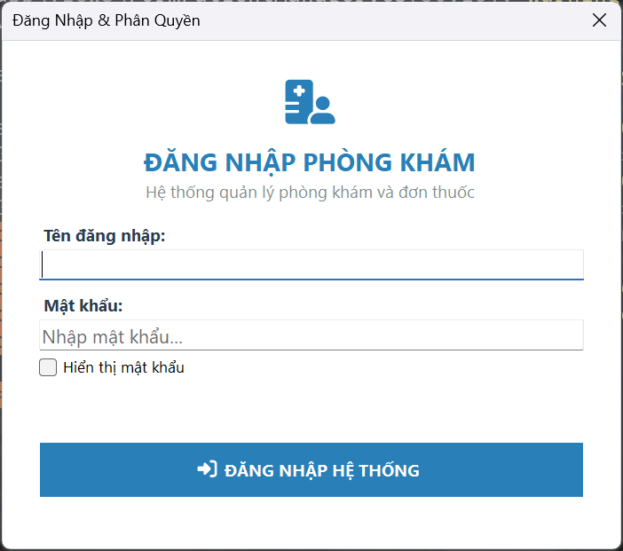

### 2. Đăng xuất / Đổi tài khoản
* Ở góc trên bên phải thanh tiêu đề màu xanh luôn hiển thị **Họ tên (Vai trò)** người đang sử dụng.
* Khi muốn đổi ca hoặc chuyển sang tài khoản khác, bấm nút **Đăng xuất** (màu đỏ) ở góc trên bên phải $\rightarrow$ chọn **Yes** để quay lại màn hình đăng nhập.

---

## PHẦN 1: LỄ TÂN & PHÒNG CHỜ

*Dành cho **Lễ tân** và **Quản trị viên**. Mở tại mục **Lễ Tân & Bệnh Nhân** trên menu bên trái.*

### 1.1. Tiếp nhận bệnh nhân & Cấp số thứ tự khám

Màn hình chia làm 2 phần: **bên trái** để nhập thông tin & cấp số, **bên phải** là **Danh sách hàng đợi khám hôm nay** (tự động cập nhật mới mỗi 3 giây).

**Các bước tiếp nhận bệnh nhân:**
1. **Nếu là bệnh nhân cũ (đã từng đến khám):**
   * Gõ **SĐT hoặc Họ tên** vào ô **Tra cứu nhanh BN cũ** rồi bấm nút **Tìm** (hoặc nhấn `Enter`). Thông tin bệnh nhân sẽ tự động điền vào các ô bên dưới.
   * Hoặc bấm nút **Chọn hồ sơ** để mở toàn bộ danh sách bệnh nhân và chọn trực tiếp.
2. **Nếu là bệnh nhân mới:**
   * Điền trực tiếp **Họ và tên bệnh nhân (*)**, **Số điện thoại (*)**, chọn **Giới tính**, nhập **Năm sinh** và **Địa chỉ liên hệ**.
3. Bấm nút xanh lá **LƯU & CẤP SỐ THỨ TỰ KHÁM**.
   * Số thứ tự mới sẽ hiện lớn ở khung **Phiếu số thứ tự vừa cấp trong ngày** phía dưới, đồng thời bệnh nhân xuất hiện ngay trên bảng hàng đợi bên phải và trên TV phòng chờ.

**Giải thích các nút & ký hiệu trên màn hình Tiếp nhận:**
* **Tìm:** Tìm nhanh hồ sơ bệnh nhân cũ theo tên hoặc số điện thoại để đỡ phải gõ lại.
* **Chọn hồ sơ:** Mở cửa sổ **Quản Lý Hồ Sơ Bệnh Nhân** (xem mục 1.2) để thêm, sửa, xóa hồ sơ hoặc xem lịch sử đến khám.
* **LƯU & CẤP SỐ THỨ TỰ KHÁM:** Lưu thông tin (nếu là khách mới) và cấp STT kế tiếp trong ngày cho bệnh nhân vào hàng đợi.
* **Làm mới:** Xóa trắng các ô đang nhập để chuẩn bị tiếp nhận bệnh nhân tiếp theo.
* **Mở TV Phòng Chờ:** Mở cửa sổ màn hình TV phòng chờ (xem mục 1.3).
* **Thống Kê BN:** Mở cửa sổ báo cáo số lượng bệnh nhân theo ngày (xem mục 1.4).
* **Màu sắc trạng thái trong bảng hàng đợi:**
  * **Vàng (`Đang chờ`):** Bệnh nhân đã lấy số, đang ngồi đợi Bác sĩ gọi.
  * **Xanh dương (`Đang khám`):** Bệnh nhân đang được Bác sĩ khám trong phòng.
  * **Cam (`Chờ thu phí`):** Bác sĩ đã khám xong, bệnh nhân cần ra quầy Thu ngân thanh toán.
  * **Xanh lá (`Đã hoàn tất`):** Đã thanh toán và nhận thuốc xong.
  * **Xám (`Đã hủy`):** Lượt khám bị hủy do bệnh nhân vắng mặt.

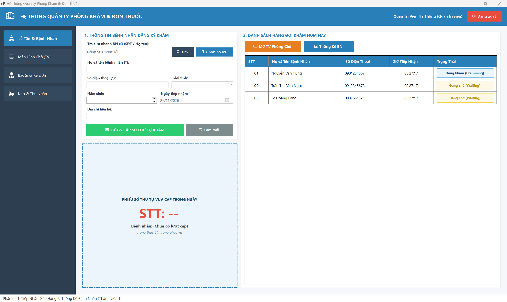

---

### 1.2. Quản lý hồ sơ bệnh nhân

*Mở từ nút **Chọn hồ sơ** trên màn hình Lễ tân.*

**Các thao tác chính:**
* **Tìm kiếm hồ sơ:** Nhập họ tên hoặc SĐT vào ô tìm kiếm $\rightarrow$ bấm **Tìm kiếm** (hoặc nhấn `Enter`). Bấm **Hiện tất cả** để tải lại toàn bộ danh sách.
* **Chọn bệnh nhân để cấp số:** Bấm chọn 1 bệnh nhân trong bảng bên trái $\rightarrow$ bấm nút xanh lá **Cấp STT Khám Cho BN Đang Chọn** (hoặc **nhấp đúp chuột** vào dòng bệnh nhân đó) để đưa ngay thông tin về màn hình Tiếp nhận.
* **Xem lịch sử đến khám:** Chọn 1 bệnh nhân $\rightarrow$ bấm nút **Lịch Sử Khám** để xem các ngày bệnh nhân từng đến phòng khám, STT và trạng thái từng lượt.
* **Thêm / Sửa / Xóa hồ sơ (khung bên phải):**
  * **Nhập Mới:** Xóa trắng các ô bên phải để bắt đầu tạo hồ sơ mới.
  * **Thêm Mới:** Lưu một hồ sơ bệnh nhân mới vào danh sách.
  * **Lưu Sửa:** Chọn 1 bệnh nhân ở bảng bên trái, sửa thông tin ở khung bên phải rồi bấm **Lưu Sửa** để cập nhật.
  * **Xóa Hồ Sơ:** Chọn 1 bệnh nhân và bấm **Xóa Hồ Sơ** $\rightarrow$ xác nhận **Yes** (chỉ xóa được những hồ sơ chưa có lịch sử khám/bệnh án).

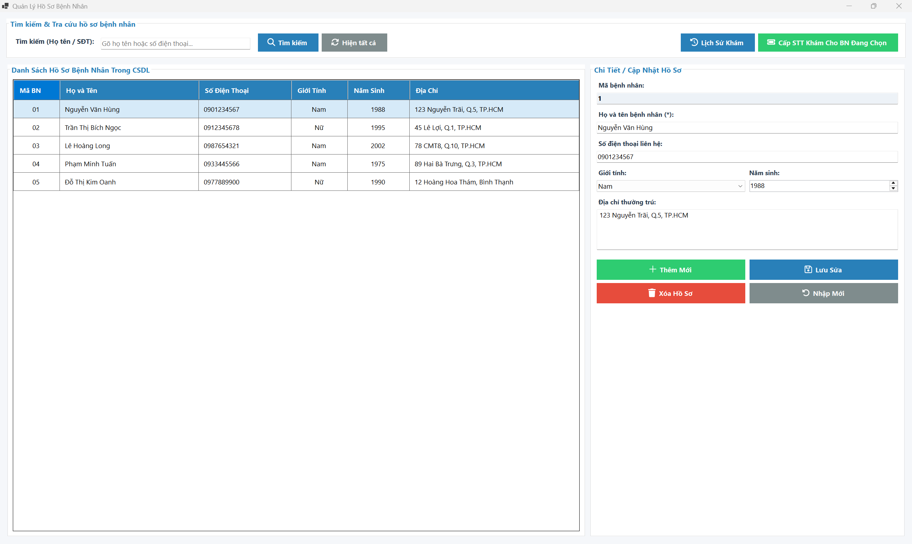

---

### 1.3. Màn hình TV phòng chờ

*Mở từ mục **Màn Hình Chờ (TV)** trên menu bên trái hoặc nút **Mở TV Phòng Chờ** ở màn hình Lễ tân.*

* Đây là cửa sổ hiển thị riêng (có thể kéo sang màn hình TV hoặc máy chiếu ngoài sảnh chờ).
* **Bên trái:** Hiển thị nổi bật **Số thứ tự** và **Họ tên bệnh nhân đang được mời vào khám** cùng tên phòng khám / bác sĩ.
* **Bên phải:** Hiển thị danh sách **Bệnh nhân đang đợi** theo thứ tự và tổng số người đang chờ.
* Màn hình tự động làm mới liên tục theo thời gian thực khi Lễ tân cấp số mới hoặc khi Bác sĩ gọi bệnh nhân tiếp theo — nhân viên không cần bấm tải lại.

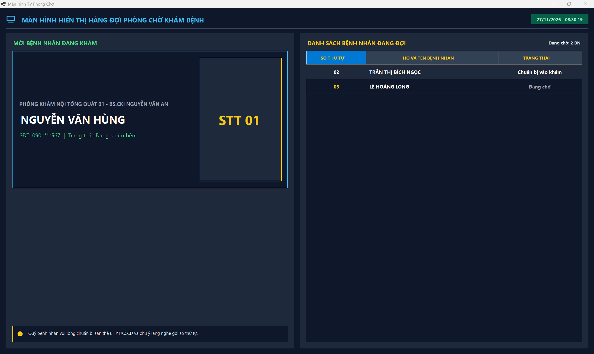

---

### 1.4. Báo cáo & Thống kê bệnh nhân theo ngày

*Mở từ nút **Thống Kê BN** trên màn hình Lễ tân.*

1. Chọn khoảng thời gian ở ô **Từ ngày** và **Đến ngày** (mặc định là 30 ngày gần nhất).
2. Bấm nút **Lọc thống kê** để xem số liệu trong khoảng ngày đã chọn.
3. Xem nhanh 4 thẻ tổng hợp phía trên (**Tổng lượt đăng ký**, **Đã khám hoàn tất**, **Đang chờ / Đang khám**, **Trung bình mỗi ngày**) và bảng chi tiết theo từng ngày phía dưới (kèm tỷ lệ hoàn thành).
4. Bấm nút **Làm mới dữ liệu** để đặt lại khoảng 30 ngày gần nhất và cập nhật số liệu mới nhất.

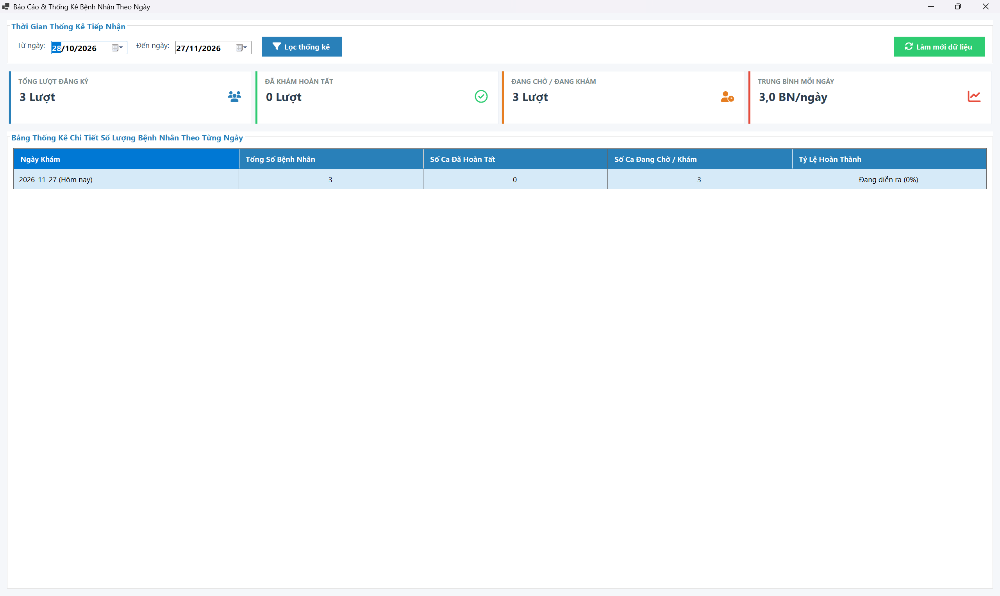

---

## PHẦN 2: BÁC SĨ KHÁM BỆNH & KÊ ĐƠN THUỐC

*Dành cho **Bác sĩ** và **Quản trị viên**. Mở tại mục **Bác Sĩ & Kê Đơn** trên menu bên trái.*

### 2.1. Xem hàng đợi & Gọi bệnh nhân vào khám

*Mở bằng cách bấm nút **Hàng Đợi & Gọi Khám** ở góc trên bên trái màn hình Bác sĩ.*

1. Bảng bên trái liệt kê các bệnh nhân đang chờ hoặc đang khám trong ngày. Bấm **Làm mới** nếu cần cập nhật thêm bệnh nhân Lễ tân vừa tiếp nhận.
2. Bấm chọn 1 bệnh nhân trong danh sách $\rightarrow$ thông tin STT và tên bệnh nhân sẽ hiện lớn ở thẻ bên phải.
3. Sử dụng các nút chức năng bên phải:
   * **GỌI VÀO KHÁM & MỞ PHIẾU KHÁM:** Chuyển trạng thái bệnh nhân sang *Đang khám*, đồng bộ ngay lên TV phòng chờ và mở phiếu khám cho bệnh nhân đó.
   * **Xem tiền sử khám bệnh của BN này:** Mở nhanh lịch sử các lần khám trước của chính bệnh nhân đang chọn để bác sĩ tham khảo trước khi gọi vào.
   * **Đánh dấu Vắng mặt / Hủy lượt (Cancelled):** Dùng khi gọi nhiều lần nhưng bệnh nhân không có mặt để bỏ qua lượt này.

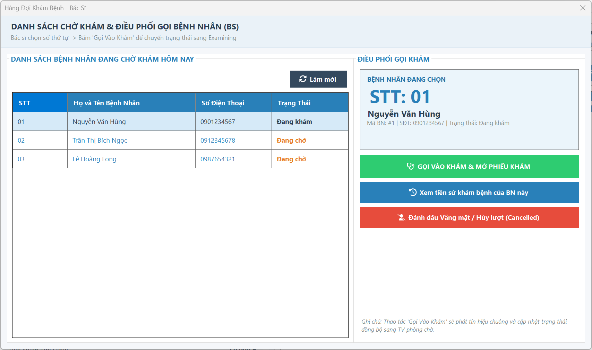

---

### 2.2. Khám lâm sàng & Kê đơn thuốc

Màn hình chính của Bác sĩ gồm 2 cột: **Cột trái (Khám lâm sàng & Chẩn đoán)** và **Cột phải (Kê đơn thuốc)**.

**Các bước thực hiện:**
1. **Kiểm tra thông tin bệnh nhân đang khám** ở hộp màu xanh trên cùng cột trái (nếu muốn đổi sang bệnh nhân khác, bấm nút **Hàng Đợi & Gọi Khám**).
2. **Nhập kết quả khám (Cột trái):**
   * Nhập **Triệu chứng lâm sàng (*)** và **Chẩn đoán bệnh (*)**.
   * Kiểm tra hoặc điều chỉnh **Tiền công khám (VNĐ)** (mặc định `50,000 đ`).
3. **Kê đơn thuốc (Cột phải — bỏ qua bước này nếu bệnh nhân không cần dùng thuốc):**
   * Gõ tên hoặc mã thuốc vào ô **Gõ tên thuốc hoặc mã thuốc** $\rightarrow$ phần mềm sẽ tự động gợi ý các thuốc đang còn trong kho.
   * Ô **Tồn kho & Đơn giá hiện tại** bên cạnh sẽ tự báo ngay số lượng còn lại và giá bán (nếu số lượng kê vượt quá tồn kho, hệ thống sẽ cảnh báo).
   * Chọn **Số lượng kê** và chọn mẫu **Liều dùng / Cách dùng** có sẵn (hoặc tự gõ cách dùng riêng).
   * Bấm nút **Thêm vào đơn** để đưa thuốc xuống bảng chi tiết bên dưới.
   * Nếu kê nhầm, chọn dòng thuốc trong bảng rồi bấm **Xóa thuốc**.
4. **Hoàn tất ca khám:**
   * Kiểm tra phần **Tổng cộng dự kiến** (Tiền khám + Tiền thuốc) ở cuối cột trái.
   * Bấm nút xanh lá **HOÀN TẤT KHÁM & CHUYỂN THU NGÂN**.
   * *Lưu ý:* Kể cả khi **không kê thuốc** (bảng thuốc trống), bác sĩ vẫn bấm **HOÀN TẤT KHÁM & CHUYỂN THU NGÂN** bình thường — hệ thống sẽ tự chuyển sang quầy Thu ngân để thu **Tiền công khám** và chốt hoàn tất lượt khám.

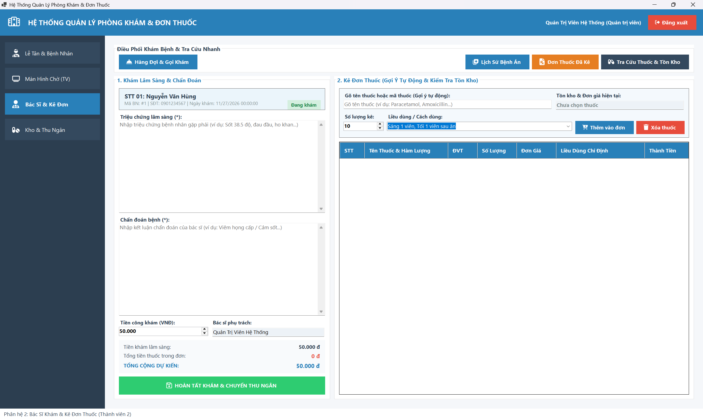

---

### 2.3. Các công cụ tra cứu nhanh của Bác sĩ

Trên thanh công cụ phía trên màn hình Bác sĩ có 3 nút hỗ trợ tra cứu nhanh bất cứ lúc nào:

* **Lịch Sử Bệnh Án:**
  * Gõ tên hoặc SĐT bệnh nhân $\rightarrow$ bấm **Tra cứu bệnh án** (hoặc nhấn `Enter`). Bấm **Hiển thị tất cả** để xem toàn bộ bệnh án đã lưu.
  * Bấm vào từng dòng trong bảng trên để đọc đầy đủ *Triệu chứng lâm sàng*, *Kết luận chẩn đoán*, *Bác sĩ khám* và *Tiền khám* ở khung chi tiết phía dưới.
* **Đơn Thuốc Đã Kê:**
  * Gồm 2 bảng song song: **bên trái** là danh sách các đơn đã kê (hiển thị rõ trạng thái *Chờ thu phí* màu cam hoặc *Đã xuất / Đã thu phí* màu xanh lá), **bên phải** là chi tiết từng thuốc trong đơn đang chọn.
  * Có ô tìm theo *Tên BN / Chẩn đoán*, nút **Tìm kiếm đơn thuốc**, nút **Hiển thị tất cả**, và ô tích **Chỉ hiện đơn có thuốc** (tích vào nếu muốn ẩn các ca khám không kê thuốc).
* **Tra Cứu Thuốc & Tồn Kho:**
  * Giúp bác sĩ xem nhanh các loại thuốc còn hàng trong kho trước khi kê.
  * Nhập tên/mã thuốc, chọn lọc theo **Đơn vị** (*Viên, Vỉ, Hộp, Tuýp, Lọ...*) rồi bấm **Lọc danh sách** (hoặc `Enter`).
  * Chú ý màu sắc cảnh báo: **Xanh ngọc** (*Đủ thuốc kê đơn*), **Cam** (*Sắp hết hàng*), **Đỏ** (*Cận hạn / Quá hạn sử dụng*).

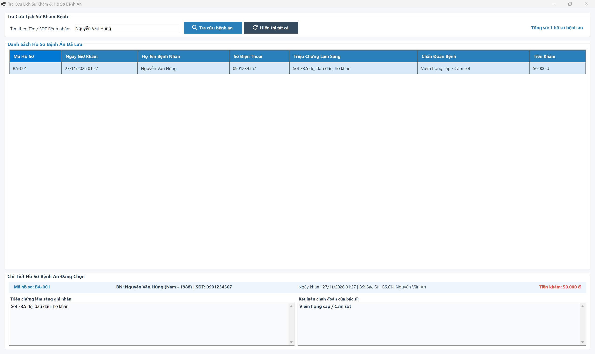

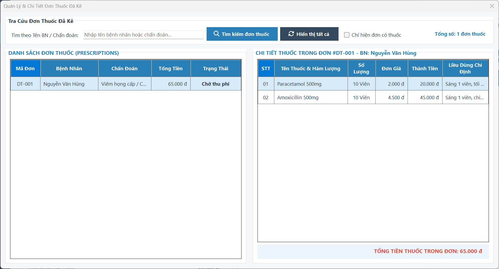

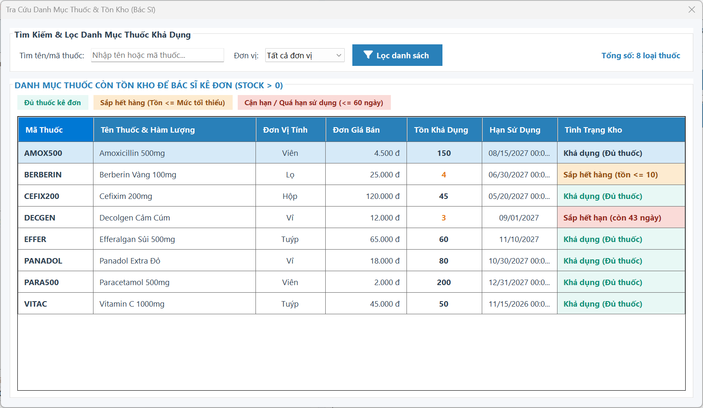

---

## PHẦN 3: THU NGÂN, IN HÓA ĐƠN & QUẢN LÝ KHO THUỐC

*Dành cho **Dược sĩ / Thu ngân** và **Quản trị viên**. Mở tại mục **Kho & Thu Ngân** trên menu bên trái.*

### 3.1. Thu phí & Xuất thuốc

Màn hình chia 2 cột: **Bên trái** là danh sách đơn chờ thanh toán, **Bên phải** là chi tiết thuốc và tính tiền.

**Các bước thu phí & xuất thuốc:**
1. Chọn 1 bệnh nhân trong bảng **1. Danh sách đơn thuốc chờ thanh toán** ở bên trái.
   * Có thể gõ tên hoặc SĐT vào ô tìm kiếm phía trên để lọc nhanh, hoặc bấm **Làm mới** để tải các đơn Bác sĩ vừa gửi qua.
2. Kiểm tra thông tin ở cột phải:
   * Xem danh sách thuốc cần lấy, cột **SL kê**, **Tồn kho** và **Sau xuất**. Nếu có thuốc nào không đủ số lượng trong kho để xuất, dòng đó sẽ tô **cảnh báo đỏ** (cần nhập kho bổ sung trước khi xuất).
   * Với ca khám **không kê thuốc**, bảng thuốc sẽ trống và **Tiền thuốc theo đơn** bằng `0 đ`, Thu ngân chỉ cần thu **Tiền khám bệnh**.
   * Đối chiếu **TỔNG THANH TOÁN** (Tiền khám + Tiền thuốc).
3. Bấm nút xanh lá **Xác nhận Thu phí & Xuất thuốc** để hoàn tất thanh toán.
   * Hệ thống sẽ tự động trừ số lượng thuốc đã xuất khỏi kho, lưu hóa đơn và đổi trạng thái bệnh nhân sang *Đã hoàn tất*.

**Giải thích các nút khác trên màn hình Quầy Thu Ngân:**
* **Xem trước & In Hóa đơn:** Mở cửa sổ xem trước và in đơn thuốc kèm hóa đơn (có thể bấm để xem trước khi thu hoặc in ngay sau khi thu).
* **Quản lý Kho Thuốc:** Mở màn hình quản lý toàn bộ danh mục thuốc và nhập kho (xem mục 3.3).
* **Báo cáo & Sổ HĐ:** Mở màn hình cảnh báo thuốc sắp hết hàng / cận hạn và nhật ký hóa đơn đã thu (xem mục 3.4).

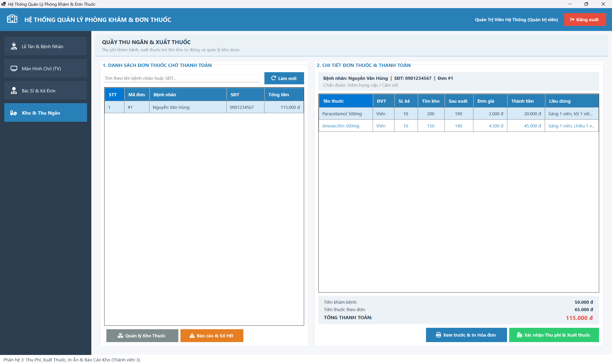

---

### 3.2. Xem trước & In đơn thuốc kèm hóa đơn

*Mở từ nút **Xem trước & In Hóa đơn** ở màn hình Thu ngân, hoặc từ nút **Xem & In Lại Hóa Đơn** trong Sổ hóa đơn.*

Thanh công cụ phía trên giúp thao tác nhanh với bản in:
* **Xem lại HĐ:** Chọn nhanh một hóa đơn đã thanh toán gần đây trong danh sách xổ xuống để xem hoặc in lại.
* **Tỷ lệ:** Chọn mức phóng to/thu nhỏ trang xem trước (*Vừa trang, 75%, 100%, 125%, 150%*).
* **Nút `<` và `>`:** Chuyển qua lại giữa các trang (khi đơn thuốc dài hơn 1 trang).
* **In Phiếu / Xuất PDF:** Mở hộp thoại in của máy tính để in ra giấy hoặc chọn máy in *Microsoft Print to PDF* để lưu thành file PDF.
* **Đóng:** Thoát cửa sổ xem trước để quay lại màn hình trước đó.

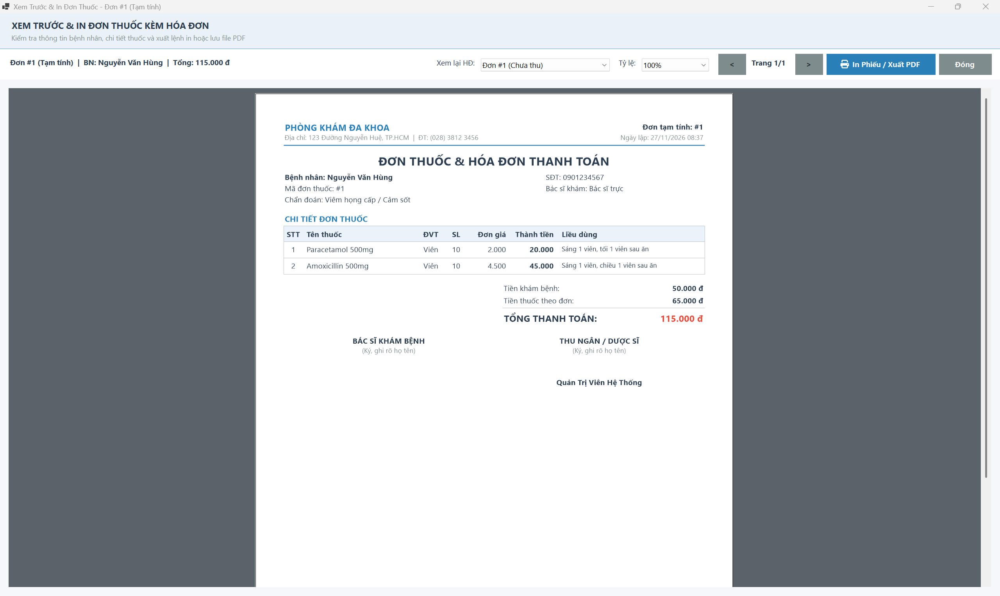

---

### 3.3. Quản lý danh mục kho thuốc & Thêm thuốc / Nhập kho

*Mở từ nút **Quản lý Kho Thuốc** ở góc dưới bên trái màn hình Thu ngân.*

**1. Xem & tìm kiếm thuốc trong kho:**
* Gõ mã hoặc tên thuốc vào ô **Tìm Mã / Tên thuốc** (danh sách tự lọc ngay khi gõ) hoặc bấm **Tìm** để tải mới dữ liệu.
* **Ý nghĩa màu sắc cảnh báo trên bảng:**
  * **Dòng màu đỏ:** Thuốc cận hạn dùng (còn $\le$ 60 ngày) hoặc đã quá hạn sử dụng.
  * **Dòng màu cam:** Thuốc sắp hết hàng (tồn kho hiện tại $\le$ mức cảnh báo tối thiểu).
  * **Dòng màu trắng:** Tình trạng kho bình thường.
* Bấm **Xem Báo Cáo Cảnh Báo** để mở nhanh màn hình tổng hợp cảnh báo & sổ hóa đơn.

**2. Thêm thuốc mới hoặc Nhập bổ sung tồn kho:**
* Bấm nút **Thêm Thuốc Mới / Nhập Kho** (hoặc **nhấp đúp chuột** vào 1 dòng thuốc trên bảng để chọn sẵn thuốc đó cần nhập thêm).
* Cửa sổ mở ra gồm 2 khung riêng biệt:
  * **Khung trái (1. Thêm Thuốc Mới Vào Kho):** Nhập *Mã thuốc (*)*, *Tên thuốc (*)*, chọn *Đơn vị tính*, *Đơn giá*, *Tồn ban đầu*, *Mức báo tồn*, *Hạn sử dụng* $\rightarrow$ bấm **Lưu Thuốc Mới Vào Kho**.
  * **Khung phải (2. Nhập Bổ Sung Tồn Kho):** Chọn thuốc trong danh sách **Chọn thuốc (*)** $\rightarrow$ xem tồn kho hiện tại $\rightarrow$ nhập **Số lượng nhập (*)**.
    * Nếu lô hàng mới có thay đổi giá hoặc hạn dùng, tích chọn vào ô **Cập nhật giá bán** và/hoặc **Cập nhật hạn dùng** rồi nhập giá trị mới.
    * Bấm **Xác Nhận Nhập Kho** để cộng dồn số lượng vào kho.
  * Bấm **Đóng / Quay lại** khi hoàn tất.

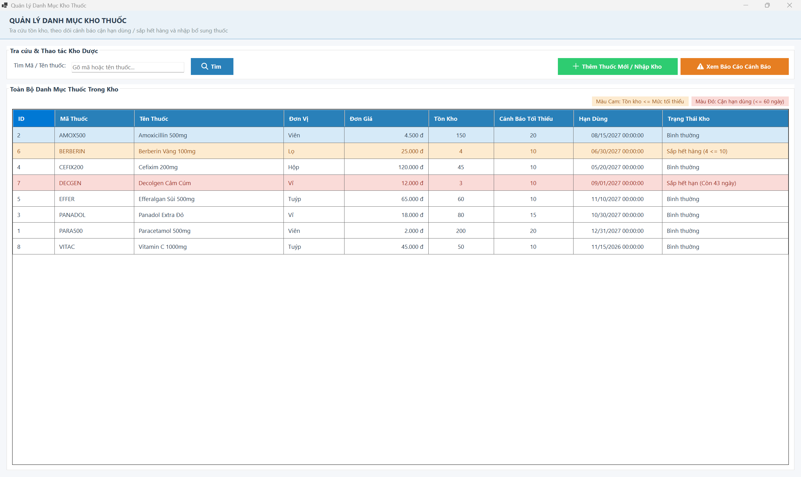

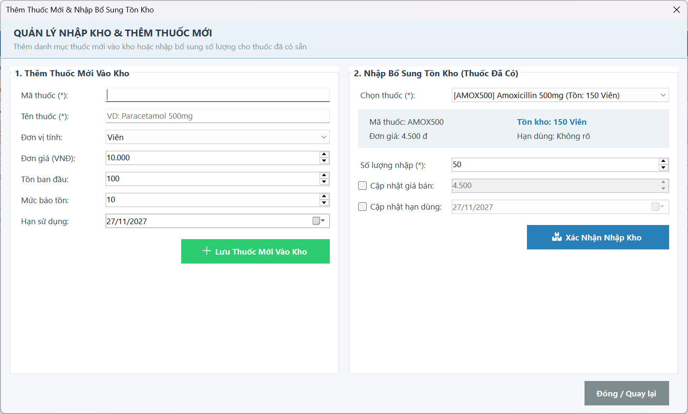

---

### 3.4. Báo cáo cảnh báo kho thuốc & Sổ hóa đơn

*Mở từ nút **Báo cáo & Sổ HĐ** trên màn hình Thu ngân hoặc nút **Xem Báo Cáo Cảnh Báo** trong Kho thuốc.*

* **4 thẻ thống kê phía trên:** Hiển thị nhanh *Thuốc sắp hết hàng*, *Thuốc cận hạn ($\le$ 60 ngày)*, *Tổng mặt hàng thuốc* và *Tổng doanh thu đã thu*.
* **Bảng bên trái (Danh sách thuốc cảnh báo tồn kho & hạn dùng):**
  * Tự động lọc riêng các thuốc đang ở mức báo động (tô đỏ nếu cận/quá hạn, tô cam nếu sắp hết hàng).
  * Chọn 1 thuốc cần nhập thêm $\rightarrow$ bấm **Nhập Bổ Sung Thuốc** để mở thẳng cửa sổ nhập kho cho đúng thuốc đó.
  * Bấm **Làm mới** để cập nhật lại báo cáo sau khi nhập kho.
* **Bảng bên phải (Nhật ký hóa đơn đã thu tiền):**
  * Lưu đầy đủ lịch sử các hóa đơn gồm *Mã HĐ, Bệnh nhân, Tiền khám, Tiền thuốc, Tổng thu, Thời gian thu*.
  * Chọn 1 hóa đơn rồi bấm **Xem & In Lại Hóa Đơn** (hoặc **nhấp đúp chuột** vào dòng hóa đơn đó) để mở bản in và in lại cho bệnh nhân khi cần.
  * Bấm **Đóng** để thoát màn hình báo cáo.

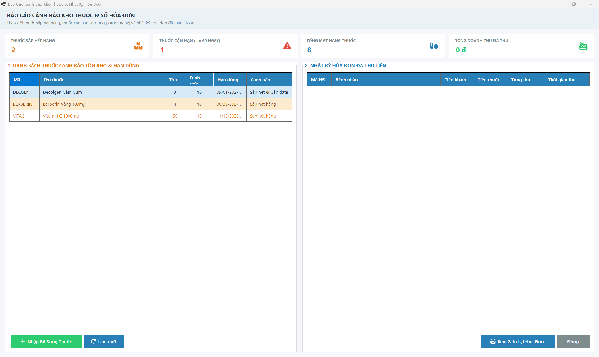
